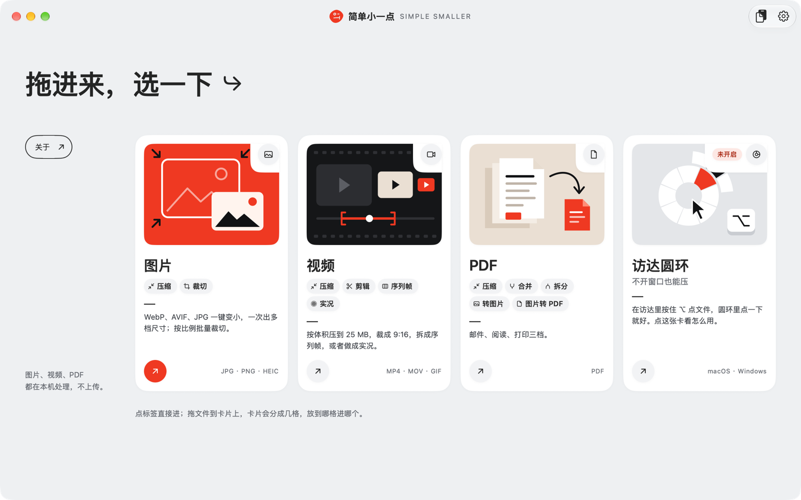
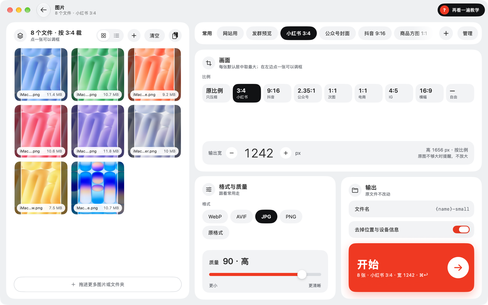

# 简单小一点 SIMPLE SMALLER

macOS / Windows 上的图片、视频、PDF 压缩与裁切工具。全部在本机处理，不上传，不用另装组件。

## 下载

最新版见 [Releases](https://github.com/IT-SIMPLE-CN/simple-smaller/releases)：mac 版找 `mac-v` 开头的版本，Windows 版找 `windows-v` 开头的版本。装好以后有新版本会在应用里提示。

## 支持的系统

- **macOS**：macOS 14 及以上，Apple 芯片与 Intel 通用。已签名并通过 Apple 公证，下载 DMG 拖进「应用程序」即可。
- **Windows**：Windows 10 2004 及以上、Windows 11，x64 与 ARM64 各一个安装程序，装到当前用户目录，不需要管理员权限。安装程序暂未签名，首次运行 SmartScreen 会拦一下，点「更多信息 → 仍要运行」。

## 能做什么

- **图片**：压缩与裁切在同一页。选「原比例」只压缩；选了比例（如小红书 3:4）就同时裁切，每张的框直接画在缩略图上，点开可以手调。输出 WebP / AVIF / JPG / PNG，可按宽、高或长边缩放，可限体积。
- **视频**：压缩（H.264 / HEVC / GIF，可限体积）、剪辑（截一段、按比例取景）、序列帧（抽成一张张图片），实况照片也能处理。
- **PDF**：压缩（文字保持清晰）、合并、拆分、转图片、图片转 PDF。带密码的文件输入密码后照样处理。
- **常用**：格式、尺寸、裁切、命名、存放位置存成一套常用设置，批量文件统一使用；可以导出发给同事。

## 用起来

- **拖放**：打开就是首页，把文件拖到对应的卡片上，或拖到窗口任何地方，按类型自动分流。
- **圆环**：在访达里按住 ⌥ 点文件（Windows：在资源管理器里按住 Alt 点文件），弹出圆环直接选怎么处理。
- **右键**：mac 在「服务」里，Windows 在资源管理器右键菜单里。
- **菜单栏 / 托盘**：常驻小窗，随时打开。
- **剪贴板自动压缩**：复制的截图自动换成压缩版（默认关）。
- **监视文件夹**：截图、下载这类文件夹里的新文件按设置自动处理。
- **撤销**：一键把这一批新文件移到废纸篓 / 回收站。
- **自动更新**：有新版本先问你，同意了才下载安装。

## 隐私

- 所有文件都在本机处理，不上传。
- 只有检查更新会联网，可以在设置里关掉。
- 原文件不动，输出写在旁边；压完反而变大的会保留原文件。

## 反馈

- 问题与建议：提 [Issue](https://github.com/IT-SIMPLE-CN/simple-smaller/issues/new/choose)。请不要附带含隐私的文件。
- 安全问题：按 [SECURITY.md](SECURITY.md) 私下报告，不要公开提 Issue。

## 从源码构建

- 构建：[docs/build.md](docs/build.md)
- 架构与约定：[docs/architecture.md](docs/architecture.md)
- 参与贡献：[CONTRIBUTING.md](CONTRIBUTING.md)

## 许可证

- 本项目按 [GNU AGPL-3.0-only](LICENSE) 开源。
- 随包的编解码组件各自遵循其许可证，清单与声明见 [THIRD_PARTY_NOTICES.md](THIRD_PARTY_NOTICES.md)，应用内「关于 › 开源组件与许可证」也能看到。
- Windows 版界面字体 MiSans 归小米所有，按其许可协议在构建时下载，不随源码分发；fork 后再分发时需遵守小米的 MiSans 许可协议。
- 视频编码涉及的专利（如 H.264、HEVC）不在本许可证的授权范围内，分发与使用请自行确认所在地区的专利要求。
- 「简单小一点」「SIMPLE SMALLER」「IT-SIMPLE」的名称与标志不随 AGPL 授权。基于本项目发布修改版时，请换用自己的名称、图标与更新源。

## 关于

© 2021–2026 IT-SIMPLE · <https://www.it-simple.cn/>
